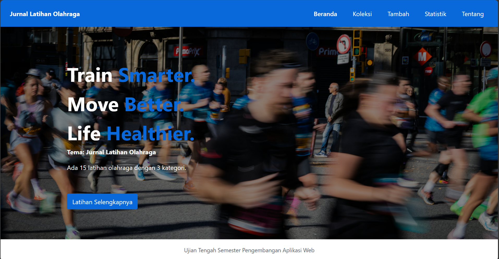
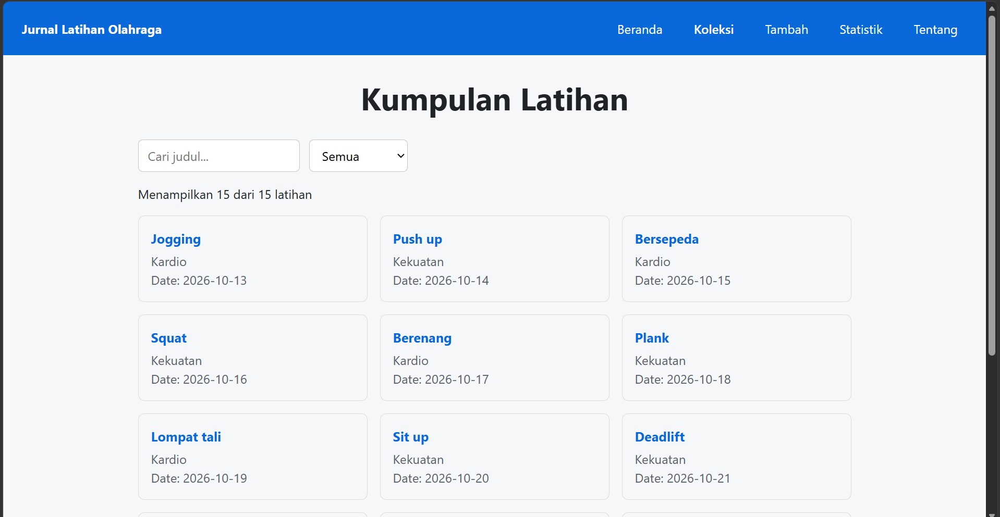
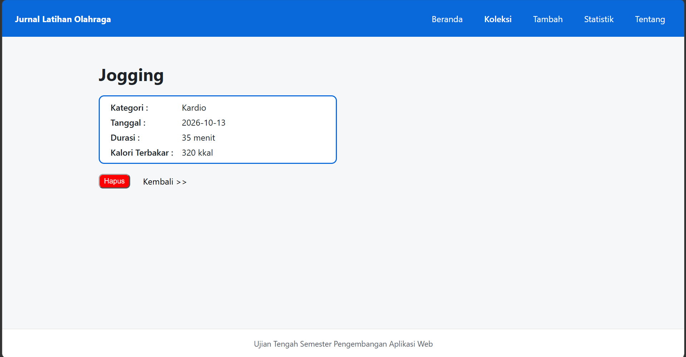
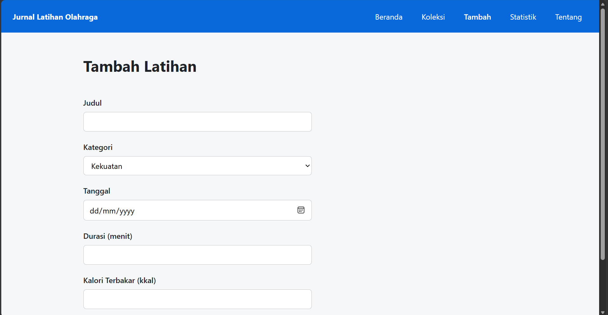
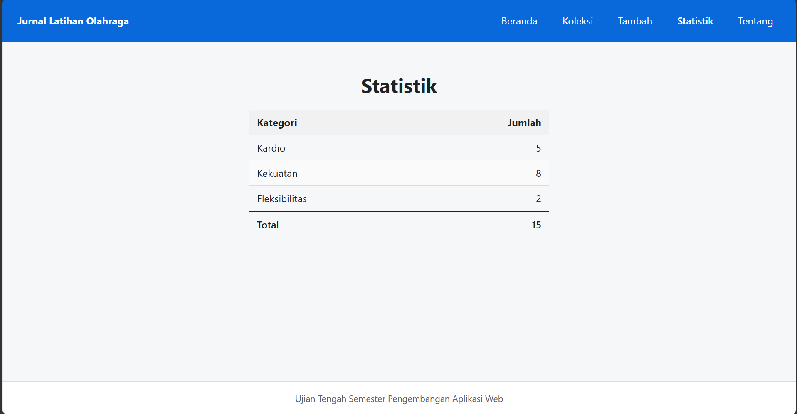
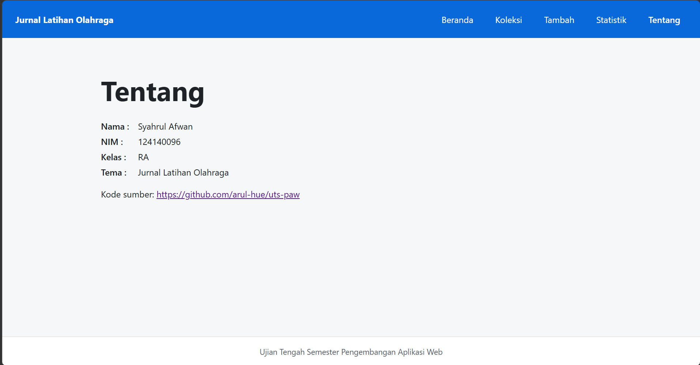

# Atleticsz - Aplikasi Pencatatan Latihan Olahraga

| | |
|---|---|
| **Nama** | Syahrul Afwan |
| **NIM** | 124140096 |
| **Kelas** | RA |
| **Tema** | Jurnal Latihan Olahraga |
| **Deployment** | https://arul-hue.github.io/uts-paw/ |

## Screenshoot Aplikasi

| Beranda                           | Koleksi                      | Detail                     |
| --------------------------------- | ---------------------------- | -------------------------- |
|  |  |  |

| Tambah                     | Statistik                        | Tentang                      |
| -------------------------- | -------------------------------- | ---------------------------- |
|  |  |  |

## Fitur

- Beranda: ringkasan jumlah latihan dan kategori.
- Koleksi: daftar latihan dengan pencarian judul dan filter kategori.
- Detail: informasi lengkap satu latihan, dengan tombol hapus.
- Tambah: form latihan baru dengan validasi judul.
- Statistik: jumlah latihan per kategori.
- Tentang: identitas pembuat dan tautan kode sumber.

## Menjalankan secara lokal

```
cd app
npm install
npm run dev
```

## Konsep React yang dipakai

- Komponen dan props (KartuItem, KotakPencarian, PilihKategori)
- useState untuk form terkontrol, pencarian, dan filter
- useEffect untuk memuat data dari koleksi.json
- Context (KoleksiProvider) dan custom hook (useKoleksi, useLocalStorage)
- React Router: NavLink, Link, useParams, useNavigate
- Conditional rendering untuk status loading, error, dan data kosong
- Data disimpan di localStorage agar tetap ada setelah refresh
- Testing dengan Vitest dan Testing Library
